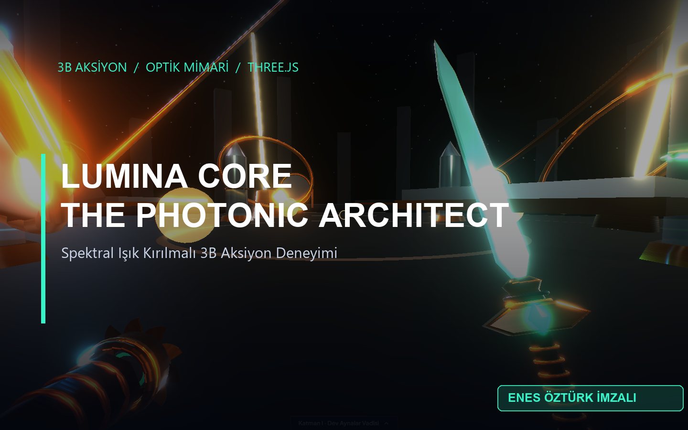
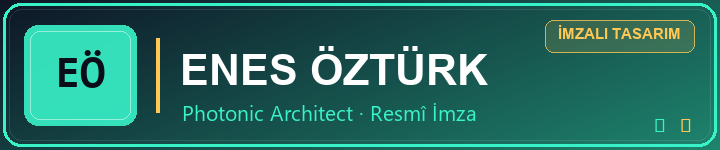
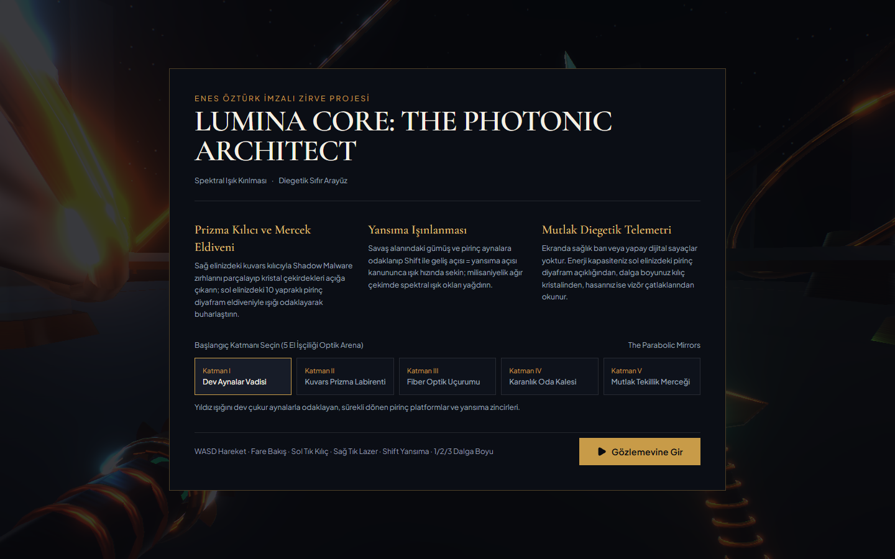
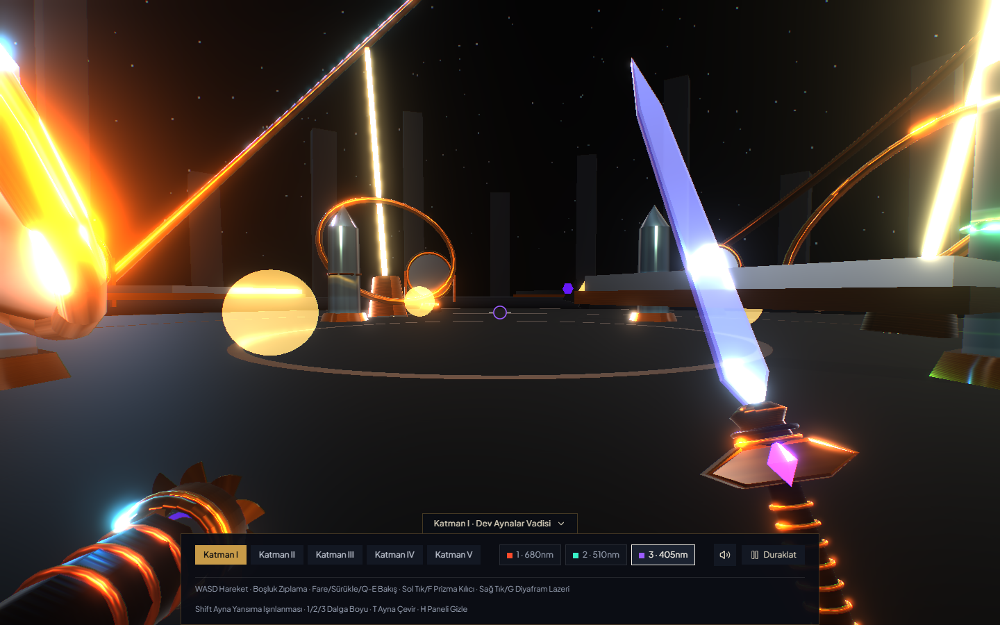

<div align="center">



# Lumina Core: The Photonic Architect

**Enes Öztürk imzalı, ışığı bir mimari malzeme olarak kullanan gerçek zamanlı 3B aksiyon deneyimi.**

[](https://github.com/EnesBinMalik/lumina-core-photonic-architect)
[](https://react.dev/)
[](https://www.typescriptlang.org/)
[](https://threejs.org/)
[](https://vite.dev/)

[](https://github.com/EnesBinMalik)
[](https://github.com/EnesBinMalik/lumina-core-photonic-architect)
[](https://github.com/EnesBinMalik/lumina-core-photonic-architect)
[](https://www.apache.org/licenses/LICENSE-2.0)



</div>

---

## Hakkında

**Lumina Core**, ışığın yalnızca aydınlatma değil; bir silah, bir köprü ve bir fizik yasası olduğu bir optik mimari evrenidir. Sağ elinizdeki prizma kılıcıyla zırhları parçalayıp kristal çekirdekleri açığa çıkarır, sol elinizdeki on yapraklı pirinç diyafram eldiveniyle ışığı odaklayarak hedefleri buharlaştırırsınız.

Proje; dalga boyuna bağlı kırılma indeksleri, gerçek zamanlı gölge yönlendirme, ışın izleme benzeri yansıma zincirleri ve tamamen diegetik bir arayüzü tek bir tarayıcı deneyiminde birleştirir. Tüm optik sistem **Three.js** ile sıfırdan yazılmıştır.

> Bu proje **Enes Öztürk** tarafından tasarlanmış, geliştirilmiş ve imzalanmıştır.

---

## Öne çıkan özellikler

| Özellik | Açıklama |
| --- | --- |
| **Spektral dalga boyları** | 680 nm kızılötesi, 510 nm görünür ve 405 nm morötesi; her birinin farklı kırılma indeksi, ısı oranı ve ses perdesi. |
| **Prizma Kılıcı** | Düşmanların zırh plakalarını kırarak içteki kristal çekirdeği açığa çıkarır. |
| **Mercek Eldiveni** | 10 yapraklı pirinç diyafram ile ışığı odaklar, açığa çıkan hedefi termal olarak yok eder. |
| **Optik mimari** | Dönen çukur aynalar, prizma sütunları, borosilikat cam tüpler ve mekanik diyafram zeminleri. |
| **Yansıma zincirleri** | Aynalar arasında yönlendirilen ışık, yeni platformlar ve odak noktaları oluşturur. |
| **5 katman** | Dev Aynalar Vadisi'nden Mutlak Tekillik Merceği'ne uzanan el yapımı seviyeler. |
| **Düşman çeşitliliği** | `stalker`, `sentinel` ve boss `leviathan` tipleri; zırh ve çekirdek ayrı can sistemleri. |
| **Kombo ve dalga sistemi** | Zincirleme yok etmeler kombo çarpanı üretir; her katman iki dalgadan oluşur. |
| **Diegetik arayüz** | Bilgiler HUD'da değil; kılıç, eldiven ve ortamdaki optik yüzeylerde gösterilir. |
| **Apache-2.0 kaynak başlığı** | Kaynak dosyalar açık kaynak lisans başlığıyla işaretlenmiştir. |

---

## Spektrum sistemi

| Bant | Dalga boyu | Renk | Kırılma indeksi (IOR) | Isı oranı |
| --- | --- | --- | --- | --- |
| Kızılötesi | 680 nm | `#FF4B2B` | 1.51 | 1.45× |
| Görünür | 510 nm | `#38F2C8` | 1.55 | 1.00× |
| Morötesi | 405 nm | `#9B5CFF` | 1.61 | 1.20× |

Dalga boyu değiştirmek yalnızca rengi değil; kırılma açısını, ısı birikim hızını ve ışın sesinin perdesini de değiştirir.

---

## Katmanlar

| # | Katman | Ortam |
| --- | --- | --- |
| I | Dev Aynalar Vadisi — *The Parabolic Mirrors* | Yıldız ışığını odaklayan çukur aynalar ve dönen pirinç platformlar. |
| II | Kuvars Prizma Labirenti — *The Spectral Labyrinth* | Kırmızı yakıcı ışınlar, mavi fotonik köprüler, mor yerçekimi tersleyiciler. |
| III | Fiber Optik Uçurumu — *The Total-Reflection Chasm* | Sıvı ışık taşıyan borosilikat borular ve pirinç köprüler. |
| IV | Karanlık Oda Kalesi — *The Camera Obscura Bastion* | Diyafram kapaklarından sızan ışığı gölgelere yönlendirme. |
| V | Mutlak Tekillik Merceği — *The Singularity Lens* | Kara Madde Algoritması *Umbra Leviathan* ile final yüzleşmesi. |

---

## Kontroller

| Tuş | Aksiyon |
| --- | --- |
| `W` `A` `S` `D` | Hareket |
| `Boşluk` | Zıplama |
| `Fare` / `Sürükle` / `Q` `E` | Bakış açısı |
| `Sol tık` / `F` | Prizma Kılıcı |
| `Sağ tık` | Mercek diyaframı — ışığı odakla |
| `1` – `5` | Katman seçimi |
| `H` | Görünür / morötesi / kızılötesi geçişi |
| `ESC` | Fare kilidinden çıkış |

---

## Galeri





---

## Kurulum

**Gereksinimler:** Node.js 20+ ve modern bir WebGL tarayıcı.

```bash
git clone https://github.com/EnesBinMalik/lumina-core-photonic-architect.git
cd lumina-core-photonic-architect
npm install
npm run dev
```

Uygulama varsayılan olarak `http://localhost:3000` adresinde açılır.

> `.env.example` dosyası yalnızca AI Studio dağıtım şablonu içindir. Oyun tamamen istemci tarafında çalışır; yerel oynamak için API anahtarı gerekmez.

Diğer komutlar:

```bash
npm run build     # Üretim derlemesi (dist/)
npm run preview   # Derlemeyi yerelde önizle
npm run lint      # TypeScript tip kontrolü
```

---

## Teknik mimari

```text
src/
├── App.tsx                  Uygulama kabuğu, UI köprüsü, katman seçimi
├── main.tsx                 React giriş noktası
├── engine/
│   ├── PhotonicEngine.ts     Three.js sahnesi, optik sistem, fizik ve düşman AI
│   └── types.ts              Dalga boyu, katman, ayna, prizma ve düşman tipleri
├── components/              Diegetik arayüz bileşenleri
└── styles.css               Tailwind 4 ve özel tipler
```

`EngineUiBridge` arayüzü, motorun durumunu React'e yalnızca gerekli alanlarla (`gameState`, `combo`, `waveIndex`, `wavelength`, `nearInteractable`) aktarır. Oyun döngüsü `requestAnimationFrame` içinde, arayüz güncellemeleri ise tepkisel olarak yönetilir.

---

## İmza

<div align="center">

[](https://github.com/EnesBinMalik)
[](https://github.com/EnesBinMalik)

**Bu kod, tasarım ve deneyim Enes Öztürk'ün kişisel imzasını taşır.**

© 2026 Enes Öztürk — Apache-2.0 lisanslı kaynak.

</div>
